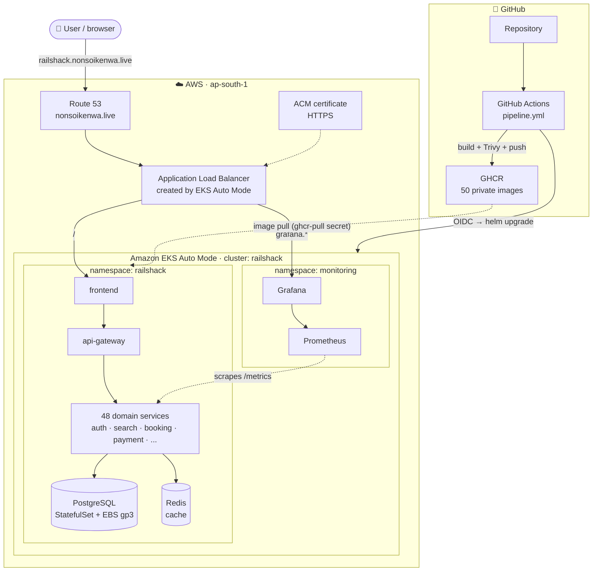
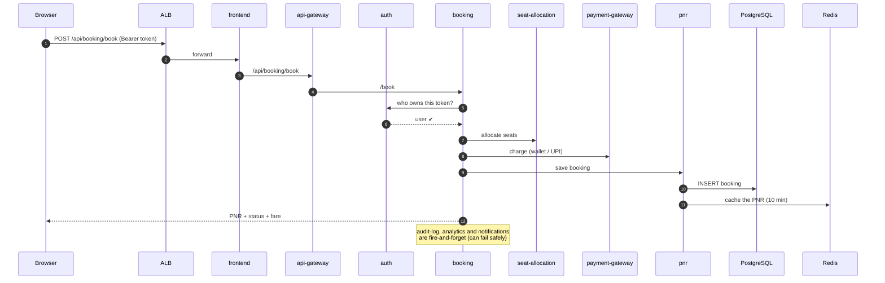
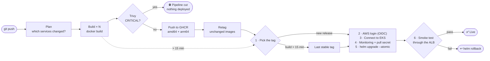

# 🚆 RailShack on AWS EKS

A train booking platform made of **50 microservices**, deployed to **Amazon EKS (Auto Mode)** with **one Helm chart**, shipped by a **GitHub Actions** pipeline that builds, scans, deploys and smoke-tests every release.

**Live:** https://railshack.nonsoikenwa.live · **Grafana:** https://grafana.railshack.nonsoikenwa.live

> Built on **RailShack · 50 Microservices Project by [DevOps Shack](https://devopsshack.com)** (Aditya Jaiswal), licensed under Apache 2.0. See [Credits & license](#-credits--license).

---

## 📑 Contents

- [What it does](#-what-it-does)
- [Architecture](#-architecture)
- [The 50 services](#-the-50-services)
- [Tools and technologies](#-tools-and-technologies)
- [CI/CD pipeline](#-cicd-pipeline)
- [Project structure](#-project-structure)
- [Setup from scratch (macOS)](#-setup-from-scratch-macos)
- [Running the pipeline](#-running-the-pipeline)
- [Monitoring: Prometheus + Grafana](#-monitoring-prometheus--grafana)
- [Daily teardown and setup (saving money)](#-daily-teardown-and-setup-saving-money)
- [Costs](#-costs)
- [Troubleshooting](#-troubleshooting)
- [Credits & license](#-credits--license)

---

## ✨ What it does

RailShack works like a real train booking site:

- **Search** trains between stations, see classes, fares and seat availability
- **Sign up / sign in**, then **book** tickets with passengers, coupons, insurance and wallet/UPI payment
- **PNR status**, **My Trips**, **cancellation with refund**
- Extras: live train status, platform info, food ordering, retiring rooms, cabs, tourism packages
- An **ops dashboard** and full **Prometheus + Grafana** monitoring

Browsing is open to everyone. Booking, My Trips and cancelling need an account (demo login: `devopsshack` / `devopsshack`).

---

## 🏗 Architecture

### High-level



**How a request flows:** the browser only ever talks to `frontend`. Every API call goes through `api-gateway`, which routes `/api/<service>/*` to `http://<service>:8080` inside the cluster. Only `frontend` is exposed to the internet; the other 49 services are internal (`ClusterIP`).

### Example: booking a ticket



Every response carries an `X-Trace` header listing each service the request touched, e.g.
`frontend,api-gateway,rate-limiter,search,routes,trains,schedules,stations,seat-map,fares`.

More diagrams drawn from the real calls in the code: [`docs/architecture/`](docs/architecture) (`overview.png`, `call-map.png`, `call-map-booking.png`, `edges.json`).

### Data layer: PostgreSQL + Redis (cache-aside)

| Service | PostgreSQL (source of truth) | Redis cache |
|---|---|---|
| `auth` | `users` (salted PBKDF2 password hashes) | none |
| `pnr` | `bookings` | `pnr:<pnr>` for 10 min |
| `booking-history` | `trips` (My Trips) | `trips:<user>` for 5 min |

- **Read:** try Redis first; on a miss, read PostgreSQL and fill the cache.
- **Write:** write PostgreSQL first, then delete the cached copy.
- PostgreSQL runs as a StatefulSet on a **10 GiB encrypted gp3 EBS volume**. Redis is a pure in-memory cache (losing it loses nothing).

### What every service guarantees

- `/healthz` and `/readyz` for Kubernetes probes, `/metrics` for Prometheus
- One JSON log line per request with a request ID
- Config only from environment variables; timeouts on every downstream call
- Graceful shutdown on `SIGTERM`; runs as **non-root** with a read-only filesystem

---

## 🧩 The 50 services

**22 Go · 18 Node.js · 6 Python · 4 Java**, with **zero third-party packages**: each service uses only its language's standard library.

| Domain | Services |
|---|---|
| **Users & Auth** (6) | `auth` (Go) · `user-profile` (Node) · `passengers` (Node) · `kyc` (Python) · `notifications` (Go) · `preferences` (Node) |
| **Trains & Search** (8) | `stations` (Go) · `trains` (Go) · `routes` (Go) · `schedules` (Java) · `search` (Go) · `seat-map` (Go) · `fares` (Java) · `quota` (Go) |
| **Booking** (10) | `booking` (Go) · `pnr` (Go) · `seat-allocation` (Go) · `waitlist` (Node) · `rac` (Node) · `tatkal` (Python) · `cancellation` (Node) · `refunds` (Go) · `booking-history` (Node) · `ticket-pdf` (Python) |
| **Payments** (6) | `payment-gateway` (Go) · `wallet` (Go) · `upi` (Node) · `invoices` (Java) · `offers` (Node) · `settlements` (Python) |
| **Travel Extras** (8) | `live-status` (Go) · `platform-info` (Node) · `food-ordering` (Node) · `retiring-rooms` (Python) · `tourism` (Node) · `cab-booking` (Go) · `insurance` (Java) · `chart-preparation` (Python) |
| **Platform** (12) | `api-gateway` (Go) · `config` (Go) · `rate-limiter` (Go) · `audit-log` (Go) · `analytics` (Node) · `search-indexer` (Go) · `email` (Node) · `sms` (Node) · `scheduler` (Go) · `feedback` (Node) · `admin` (Node) · `frontend` (Node) |

Plus two data components: **PostgreSQL 16** and **Redis 7**.

Shared runtime code lives in [`libs/`](libs) (`gokit`, `nodekit`, `pykit`, `javakit`). The full list with local ports is in [`services.json`](services.json).

**Images:** one Dockerfile per service, built from the repo root. Go images are `distroless/static` (cross-compiled), Node/Python are `alpine`, Java is `temurin` JRE. All run as non-root and are multi-arch (**amd64 + arm64**).

---

## 🛠 Tools and technologies

| Area | Tool | Used for |
|---|---|---|
| **Cloud** | AWS (ap-south-1) | Hosting everything |
| **Kubernetes** | Amazon EKS **Auto Mode** | Managed cluster; Auto Mode provides Karpenter (nodes), the load balancer controller and the EBS CSI driver built in |
| **Cluster creation** | `eksctl` | Creates the cluster and VPC from [`cluster/eks-auto-mode.yaml`](cluster/eks-auto-mode.yaml) |
| **Packaging** | **Helm** | One chart ([`helm/railshack`](helm/railshack)) deploys all 50 services, PostgreSQL and Redis |
| **Ingress** | AWS **Application Load Balancer** | Public entry point, created from a Kubernetes Ingress |
| **TLS** | AWS **Certificate Manager (ACM)** | HTTPS certificate for `railshack.` and `grafana.railshack.nonsoikenwa.live` |
| **DNS** | **Route 53** (+ Namecheap registrar) | Hosted zone for `nonsoikenwa.live` |
| **Storage** | Amazon **EBS gp3** | Encrypted PostgreSQL volume |
| **Containers** | **Docker** + Buildx + QEMU | Multi-arch image builds |
| **Registry** | **GitHub Container Registry (GHCR)** | Stores the 50 private images |
| **CI/CD** | **GitHub Actions** | Build, scan, deploy, smoke test ([`.github/workflows/pipeline.yml`](.github/workflows/pipeline.yml)) |
| **Security scanning** | **Trivy** | Fails the pipeline on any CRITICAL vulnerability |
| **Auth to AWS** | GitHub **OIDC** + IAM role | Short-lived credentials, no AWS keys stored in GitHub |
| **Monitoring** | **Prometheus** (kube-prometheus-stack) | Scrapes all 50 services, PostgreSQL and Redis |
| **Dashboards** | **Grafana** | 4 ready-made dashboards + 11 alert rules |
| **Load testing** | **k6** | "Black Friday" load test ([`loadtest/`](loadtest)) |
| **Languages** | Go, Node.js, Python, Java | The microservices |
| **Database / cache** | PostgreSQL 16, Redis 7 | Source of truth / cache |
| **Local tools** | `aws` CLI, `kubectl`, `helm`, `eksctl`, `git` | Running everything from a Mac |

---

## 🔁 CI/CD pipeline

One workflow, [`.github/workflows/pipeline.yml`](.github/workflows/pipeline.yml), runs on every push to `main` (and by hand from the Actions tab).



| Stage | What happens |
|---|---|
| **Plan** | [`scripts/ci/plan.py`](scripts/ci/plan.py) compares with the previous commit and lists the services that changed. Only those are rebuilt. |
| **Build** | One job per changed service: build the image, **scan with Trivy**, push to GHCR as `sha-<commit>` and `latest`. |
| **Trivy gate** | Any **CRITICAL** vulnerability fails the job, stops the other builds, and nothing is deployed. |
| **Retag** | Unchanged services get the same `sha-<commit>` tag, so one tag = one complete release of all 50. |
| **1 · Pick the tag** | New tag if the build succeeded. If the build ran **longer than 15 minutes**, it drops the new release and **redeploys the last stable version** running on EKS. |
| **2 · AWS login** | Assumes the `railshack-github-deployer` role through OIDC. No stored keys. |
| **3 · Connect to EKS** | `aws eks update-kubeconfig` |
| **4 · Prepare the cluster** | Installs/updates **kube-prometheus-stack** and creates the `ghcr-pull` image pull secret. |
| **5 · Helm upgrade** | `helm upgrade --install --atomic --timeout 15m`, 2 replicas per service, domain + HTTPS. Unhealthy within 15 min → automatic rollback. |
| **6 · Smoke test** | [`scripts/ci/smoke-remote.sh`](scripts/ci/smoke-remote.sh) goes through the real ALB: all 50 healthy → sign up → sign in → search → book → PNR → My Trips → cancel. Failure → `helm rollback`. |

**Repository settings the pipeline needs** (Settings → Secrets and variables → Actions):

| Type | Name | Value |
|---|---|---|
| Secret | `AWS_ROLE_ARN` | ARN printed by `cluster/github-oidc-aws.sh` |
| Secret | `GHCR_PULL_TOKEN` | Classic PAT with only `read:packages` |
| Variable | `ACM_CERT_ARN` | The ACM certificate ARN (turns on HTTPS) |

And a GitHub **environment** named `production-eks` (Settings → Environments).

---

## 🗂 Project structure

```
.github/workflows/pipeline.yml   CI/CD: build → Trivy → GHCR → EKS → smoke test
cluster/
  eks-auto-mode.yaml             eksctl config (cluster "railshack", ap-south-1)
  github-oidc-aws.sh             OIDC provider + IAM role for GitHub Actions
  monitoring-values.yaml         kube-prometheus-stack settings
  nodepool-blackfriday.yaml      Spot NodePool for the load test
  setup.sh                       recreate the cluster in one command
  teardown.sh                    delete the cluster cleanly in one command
helm/railshack/
  values.yaml                    defaults + the list of all 50 services
  values-eks.yaml                EKS: 2 replicas, PDBs, ALB, EBS, monitoring
  values-blackfriday.yaml        HPAs + bigger PostgreSQL for the load test
  templates/                     deployments, services, ingress, HPA, PDB, postgres, redis, ...
  dashboards/                    4 Grafana dashboards (JSON)
services/<name>/                 code + Dockerfile for each of the 50 services
libs/                            shared runtimes: gokit · nodekit · pykit · javakit
scripts/
  smoke-test.sh                  end-to-end test against any URL
  ci/                            plan.py, smoke-remote.sh, start-services.sh
loadtest/                        k6 Black Friday test
docs/architecture/               diagrams + edges.json
services.json                    the 50 services, language, domain, local port
```

---

## 🚀 Setup from scratch (macOS)

### Prerequisites

```bash
brew install awscli kubectl helm eksctl
aws configure                       # access key for an admin user in your AWS account
aws sts get-caller-identity         # confirms it works
```

> The upstream docs use PowerShell. On a Mac: use `/` not `\` in paths, `$(date ...)` instead of `(Get-Date ...)`, `\` for line continuation instead of `` ` ``, and `export NAME=value` instead of `$env:NAME = "value"`.

### 1. Create the cluster (~15–20 min)

```bash
eksctl create cluster -f cluster/eks-auto-mode.yaml
kubectl get nodes
```

### 2. Domain: Route 53 hosted zone

```bash
aws route53 create-hosted-zone --name nonsoikenwa.live \
  --caller-reference "$(date +%Y-%m-%dT%H:%M:%S)"
aws route53 get-hosted-zone --id <ZONE_ID> --query "DelegationSet.NameServers" --output text
```

At **Namecheap → Domain List → Manage → Nameservers → Custom DNS**, enter the four `awsdns` name servers. Check propagation:

```bash
dig NS nonsoikenwa.live +short
```

### 3. HTTPS certificate (ACM, same region as the cluster)

```bash
export REGION=ap-south-1

CERT_ARN=$(aws acm request-certificate \
  --domain-name railshack.nonsoikenwa.live \
  --subject-alternative-names grafana.railshack.nonsoikenwa.live \
  --validation-method DNS --region $REGION \
  --query CertificateArn --output text)

# add the DNS validation records to Route 53
aws acm describe-certificate --certificate-arn $CERT_ARN --region $REGION \
  --query '{Changes: Certificate.DomainValidationOptions[].{Action: `UPSERT`, ResourceRecordSet: {Name: ResourceRecord.Name, Type: ResourceRecord.Type, TTL: `300`, ResourceRecords: [{Value: ResourceRecord.Value}]}}}' \
  --output json > validation.json
aws route53 change-resource-record-sets --hosted-zone-id <ZONE_ID> --change-batch file://validation.json

aws acm wait certificate-validated --certificate-arn $CERT_ARN --region $REGION
echo $CERT_ARN                       # save this → ACM_CERT_ARN variable
```

### 4. Let GitHub Actions deploy (OIDC)

```bash
GITHUB_REPO=chukwunonsoikenwa/train_microservice_project bash cluster/github-oidc-aws.sh
```

It prints the role ARN → save it as the `AWS_ROLE_ARN` secret. Then add `GHCR_PULL_TOKEN`, `ACM_CERT_ARN` and the `production-eks` environment ([see above](#-cicd-pipeline)).

---

## ▶️ Running the pipeline

1. **Push to `main`.** The pipeline runs automatically.
2. **First time only:** the images don't exist yet, so go to **Actions → RailShack CI/CD → Run workflow**, tick **Rebuild all 50 images**, and run it.
3. **Point the domain at the load balancer** (after the first successful deploy):

```bash
ALB=$(kubectl get ingress railshack -n railshack -o jsonpath='{.status.loadBalancer.ingress[0].hostname}')
ALB_ZONE=$(aws elbv2 describe-load-balancers --region ap-south-1 \
  --query "LoadBalancers[?DNSName=='$ALB'].CanonicalHostedZoneId" --output text)

cat > dns.json <<EOF
{"Changes":[
 {"Action":"UPSERT","ResourceRecordSet":{"Name":"railshack.nonsoikenwa.live","Type":"A","AliasTarget":{"HostedZoneId":"$ALB_ZONE","DNSName":"$ALB","EvaluateTargetHealth":false}}},
 {"Action":"UPSERT","ResourceRecordSet":{"Name":"grafana.railshack.nonsoikenwa.live","Type":"A","AliasTarget":{"HostedZoneId":"$ALB_ZONE","DNSName":"$ALB","EvaluateTargetHealth":false}}}
]}
EOF
aws route53 change-resource-record-sets --hosted-zone-id <ZONE_ID> --change-batch file://dns.json
```

4. **Deploy a specific version** any time: **Run workflow** → enter an existing tag like `sha-1a2b3c4`.

Run the smoke test yourself:

```bash
bash scripts/smoke-test.sh https://railshack.nonsoikenwa.live
```

---

## 📈 Monitoring: Prometheus + Grafana

The pipeline installs **kube-prometheus-stack** into the `monitoring` namespace. The chart adds a ServiceMonitor for all 50 services, PostgreSQL/Redis exporters, **4 dashboards** (Command Center, Service Deep Dive, Data Layer, Kubernetes Autoscaling) and **11 alert rules**.

**Grafana (public):** https://grafana.railshack.nonsoikenwa.live, user `admin`.

**On local ports:**

```bash
kubectl port-forward -n monitoring svc/monitoring-grafana 3000:80 &
kubectl port-forward -n monitoring svc/monitoring-kube-prometheus-prometheus 9090:9090 &
```

- Grafana → http://localhost:3000
- Prometheus → http://localhost:9090 (kept private on purpose: it has no login)

Grafana password:

```bash
kubectl get secret monitoring-grafana -n monitoring -o jsonpath='{.data.admin-password}' | base64 -d; echo
```

Stop the port-forwards: `pkill -f "kubectl port-forward"`

---

## 💤 Daily teardown and setup (saving money)

The cluster costs money every hour it runs, so it's deleted at the end of each session and recreated the next day.

**End of the day** (~15 min):

```bash
bash cluster/teardown.sh
```

Uninstalls the apps (so load balancers and EBS volumes are released), deletes the cluster, then checks for anything left over that still bills.

**Next day** (~20 min):

```bash
bash cluster/setup.sh
```

Recreates the cluster and re-grants the GitHub deploy role access. Then:

1. **Actions** → re-run the last successful run (or **Run workflow** with its tag)
2. Re-run the DNS step above (the new cluster gets a new load balancer address)

**Kept between sessions** (free or nearly free): ACM certificate, IAM role, OIDC provider, Route 53 zone, GHCR images, GitHub secrets.

> Data inside the cluster (bookings, accounts, Grafana changes) is deleted with it.

---

## 💰 Costs

Rough figures in ap-south-1; check the AWS pricing pages for current rates.

| Item | Cost |
|---|---|
| EKS control plane | ~$0.10 / hour |
| EKS Auto Mode management fee | added on top of EC2 for nodes it manages |
| EC2 worker nodes | depends on size and count |
| Application Load Balancer | ~$0.02+ / hour plus traffic |
| EBS gp3 (10 GiB) | ~$1 / month |
| NAT gateway (VPC from eksctl) | ~$0.05 / hour plus traffic |
| Route 53 hosted zone | $0.50 / month |
| ACM certificate · IAM · GHCR (private, small) | free |

**Always run `teardown.sh` when you're done for the day.**

---

## 🧯 Troubleshooting

| Symptom | Cause / fix |
|---|---|
| `kubectl`: connection to `127.0.0.1:6443` refused | kubectl points at a local cluster (Rancher Desktop). Run `aws eks update-kubeconfig --name railshack --region ap-south-1`. |
| `eksctl ... cluster\eks-auto-mode.yaml`: no such file | Windows path. Use `cluster/eks-auto-mode.yaml`. |
| `zsh: unknown sort specifier` | PowerShell syntax `(Get-Date ...)`. Use `"$(date +%Y-%m-%dT%H:%M:%S)"`. |
| `aws ... Unknown options: -o, none` | Older AWS CLI. Use `--output text > /dev/null` or `brew upgrade awscli`. |
| `CreateAccessEntry: invalid principal` | A brand-new IAM role isn't visible to EKS yet. Wait 30–60 s and retry. |
| `dig NS` still shows `registrar-servers.com` | Namecheap hasn't pushed the nameserver change yet. Check `dig NS nonsoikenwa.live @v2n1.nic.live +norecurse`. |
| Pipeline fails at **Retag** | Images don't exist in GHCR yet. Run the workflow with **Rebuild all 50 images**. |
| Smoke test fails at **search** right after a deploy | Java services (`schedules`, `fares`) warming up. Re-run the job. |
| Pipeline cut by **Trivy** | A CRITICAL CVE in an image. Update the base image, or set `ignore-unfixed: true` to only fail on fixable ones. |
| Pods stuck in `ImagePullBackOff` | `GHCR_PULL_TOKEN` missing or expired. Create a new PAT with `read:packages` and update the secret. |
| `git push`: `src refspec main does not match any` | No commits yet, or the branch is `master`. `git commit`, then `git branch -M main`. |

---

## 📜 Credits & license

This project is built on **RailShack · 50 Microservices Project by DevOps Shack**.

- Original author: **DevOps Shack (Aditya Jaiswal)**: https://devopsshack.com · https://www.youtube.com/@devopsshack
- Original source: https://github.com/jaiswaladi246/50-MicroServices-Project-By-DevOpsShack

Licensed under the **Apache License 2.0** (see [`LICENSE`](LICENSE)). The [`NOTICE`](NOTICE) file and the copyright headers in the source files must be kept in any copy or derivative work.

My additions: macOS setup and commands, the single CI/CD workflow with the Trivy gate and 15-minute revert, the `setup.sh` / `teardown.sh` scripts, and the deployment on `nonsoikenwa.live`.
